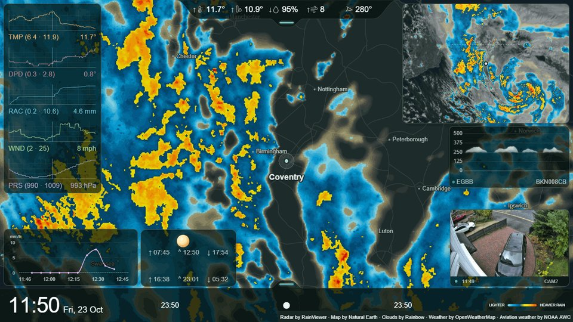
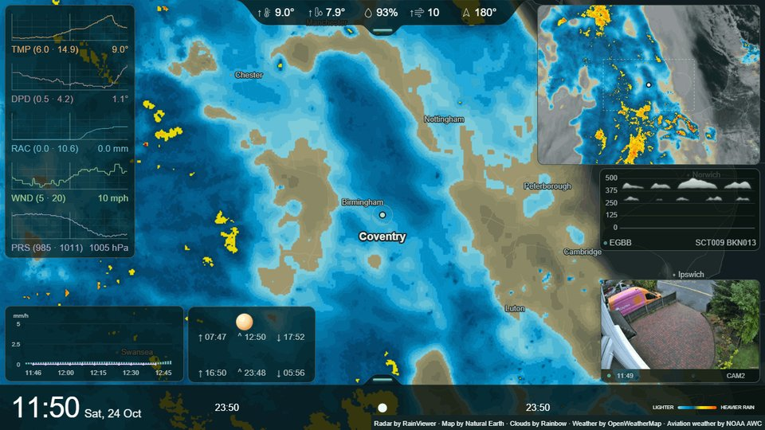
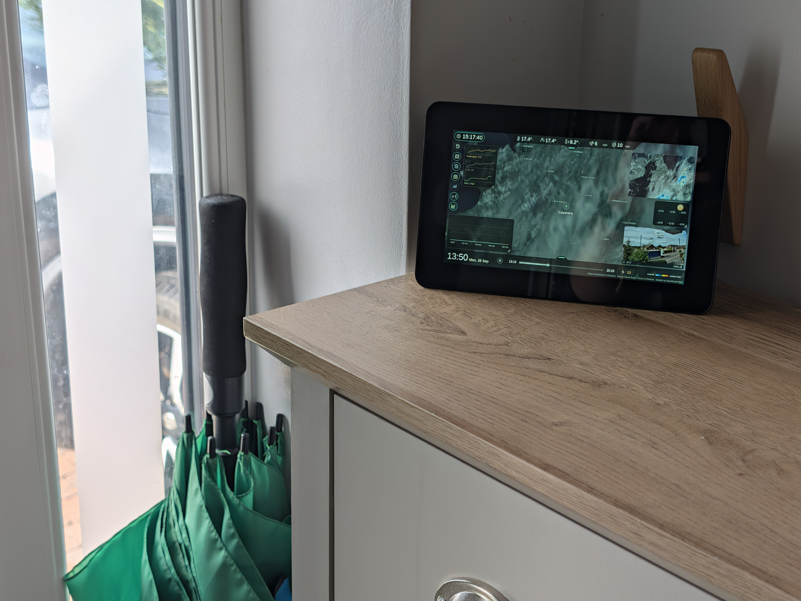
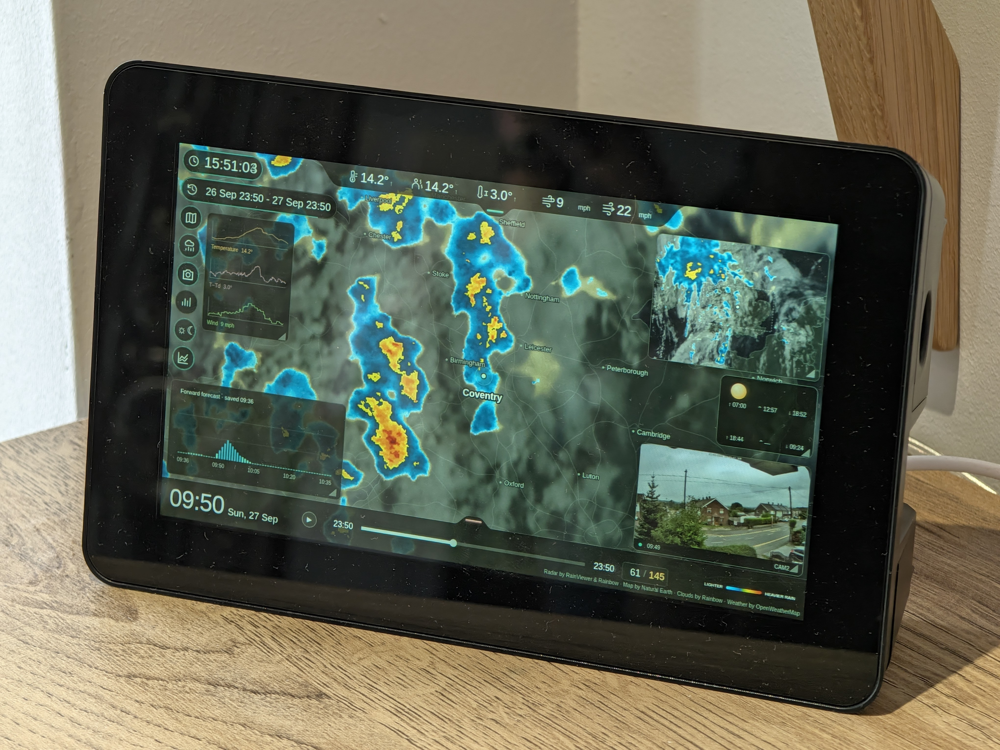
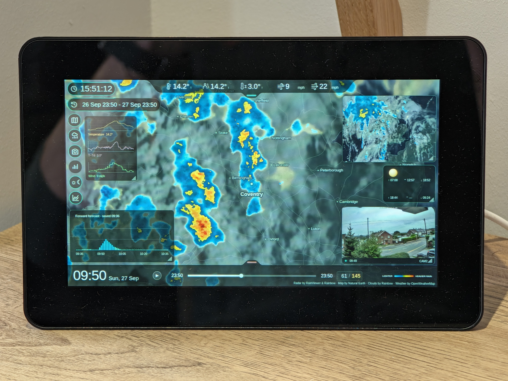
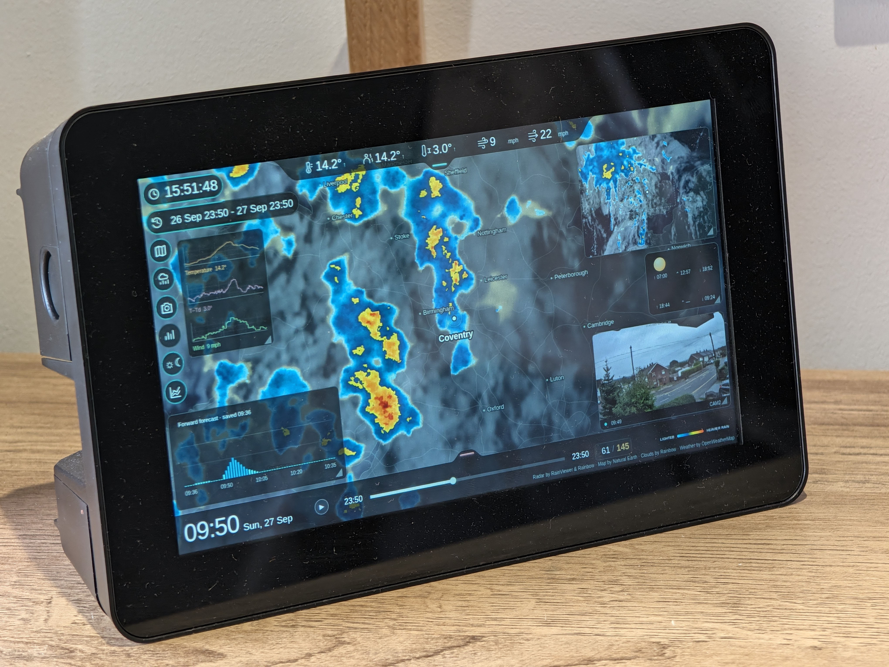
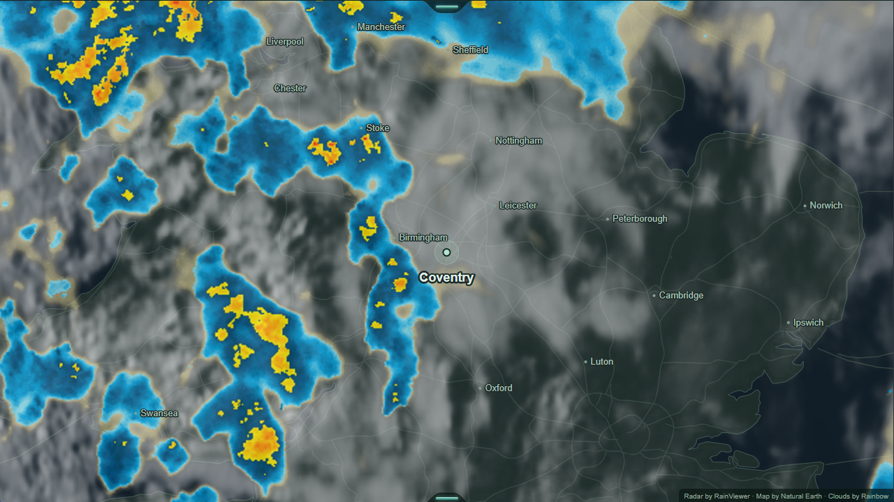
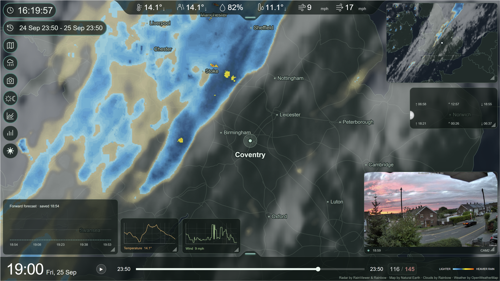

# Gallery

## Storm replays

Austen and Boelo, back to back, were the reason I wanted to keep Archive playback as a GIF. I loved watching Austen develop and did not want the replay to disappear from rolling history. These exports use **8× playback with looping enabled**, showing my current screen layout, radar/cloud layers, historical weather and camera.

Each original is **1280 × 720, 145 frames**, with an encoded cycle of about **11.72 seconds**. Click a still to open/download the complete animation; the large originals are release assets rather than automatic page downloads. These are historical recordings, not current conditions.

### Austen

[Original looping GIF — 42.6 MB](https://github.com/alex-soul/pi-rain-radar/releases/download/v0.14.0/pi-rain-radar-uk-coventry-2026-storm-austen.gif)

### Boelo

[Original looping GIF — 34.1 MB](https://github.com/alex-soul/pi-rain-radar/releases/download/v0.14.0/pi-rain-radar-uk-coventry-2026-storm-boelo.gif)

Radar by [RainViewer](https://www.rainviewer.com/) and [Rainbow](https://rainbow.ai/), clouds by Rainbow, map by [Natural Earth](https://www.naturalearthdata.com/), weather by [OpenWeather](https://openweathermap.org/), aviation weather by [NOAA AWC](https://aviationweather.gov/). Attribution remains in the originals. [Make your own GIF](archive-gif.md).

## Screens and hardware

